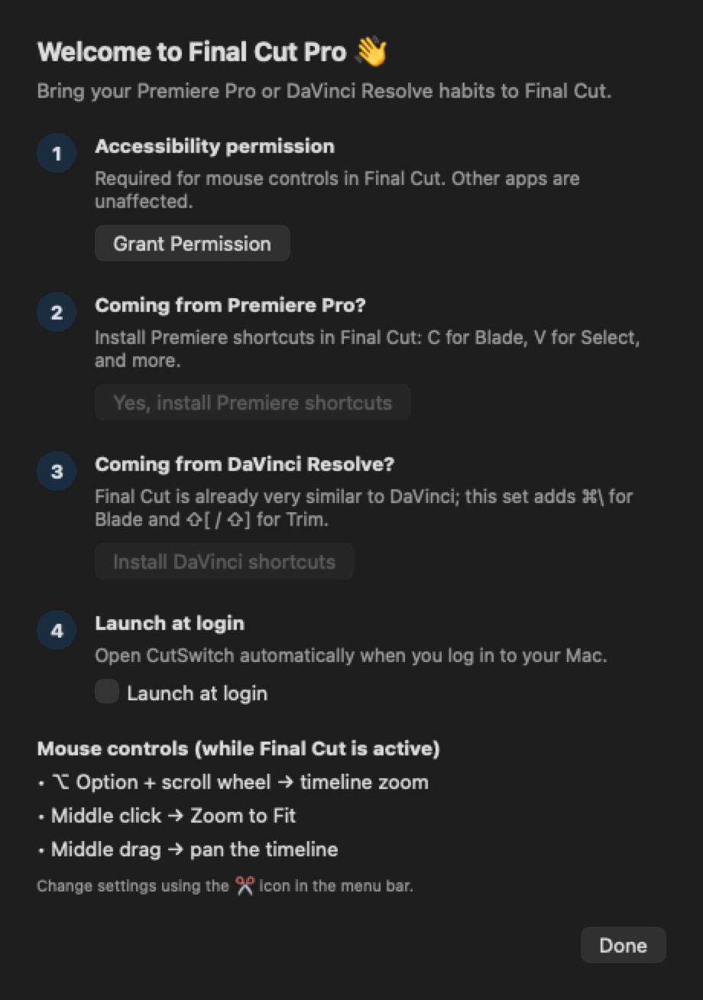

🇹🇷 [Türkçe](README.tr.md)

# ✂️ CutSwitch

**A free, open-source Mac utility for editors switching from Premiere Pro or DaVinci Resolve to Final Cut Pro.**

<p align="center"></p>

Bring years of Premiere muscle memory to Final Cut:

| What it does | How |
|---|---|
| Timeline zoom | **⌥ Option + scroll wheel** (like Alt + scroll wheel in Premiere) |
| Zoom to Fit | **Middle click** |
| Pan the timeline | **Middle drag** (like the Hand tool) |
| Premiere shortcuts | Install with one click: **C** for Blade, **V** for Select, and more |

- Zoom follows the mouse pointer while skimming is on (press **S**); otherwise it zooms around the playhead.
- Works only while Final Cut Pro is the active app; other apps are unaffected.
- Optionally launches when you log in to your Mac (Settings → "Launch at login").
- Turkish and English interface, selected automatically based on your Mac’s language.
- Works with Turkish Q / F and other keyboard layouts.
- Compatible with the standalone, Creator Studio, and trial versions of Final Cut.
- No internet connections or data collection.

---

## Installation (for users)

1. Download `CutSwitch-<version>.dmg` from [Releases](https://github.com/okaymedia/CutSwitch/releases) and drag the app to **Applications**.
2. Open it. Click **Grant Permission** in the setup window and give CutSwitch Accessibility permission in System Settings.
3. If you are coming from Premiere, click **"Yes, install Premiere shortcuts"**. Then restart Final Cut and choose **Final Cut Pro → Commands → Premiere Pro**.

If you are coming from DaVinci Resolve, click **"Install DaVinci shortcuts"**, restart Final Cut, and choose **Commands → DaVinci Resolve**: this set preserves the existing shortcuts and adds **⌘\** for Blade and **⇧[ / ⇧]** for Trim.

Settings are available through the ✂️ icon in the menu bar.

> Download the app only from this repository’s Releases page. The DMG there is signed and notarized by Apple. Do not trust copies from other sources.

### Premiere Command Set

| Premiere | Final Cut command |
|---|---|
| C | Blade |
| V | Select |
| ⌘K | Blade at Playhead |
| Q / W | Trim Start / Trim End |
| = / - | Zoom In / Zoom Out |
| \\ | Zoom to Fit |

> Final Cut’s own shortcuts are preserved. You can switch back at any time with **Commands → Default**.

---

## For developers

**Requirements:** macOS 13+, Xcode (or Command Line Tools and Swift 5.9+).

```bash
git clone https://github.com/okaymedia/CutSwitch.git
cd CutSwitch
chmod +x make-app.sh
./make-app.sh
open build/CutSwitch.app
```

> With an ad-hoc signed build, macOS may reset Accessibility permission after each rebuild. Remove CutSwitch from the list in System Settings, then add it again.

### Creating the Premiere Command Set

The Command Set is a file (`.commandset`) exported from Final Cut’s own **Command Editor**:

1. In Final Cut Pro, open **Commands → Customize** (⌥⌘K).
2. Choose **Duplicate** from the top-left menu and name it exactly **`Premiere Pro`**.
3. Apply the mappings in the table above. Find each command in the search box and drag it to the keyboard key. Choose **Reassign** if a conflict warning appears.
4. Click **Save**. Then choose **Export** from the same menu and save the file as `Resources/Premiere Pro.commandset`.
5. `./make-app.sh` automatically includes the Command Set file in the app.

### Project structure

```
Sources/CutSwitch/
  CutSwitchApp.swift        App + menu bar + launch
  MouseController.swift     Mouse event handling (CGEventTap)
  FCPMenuActions.swift      Final Cut menu commands (Accessibility API)
  CommandSetInstaller.swift Premiere Command Set installation
  Settings.swift            Settings
  Views.swift               Interface
```

**Why use menu commands instead of keyboard shortcuts?** Simulating ⌘+ for zoom hits the wrong key on a Turkish keyboard. CutSwitch instead finds Final Cut menu items with the shortcuts `⌘+`, `⌘-`, and `⇧Z` and activates them directly. This works regardless of keyboard layout or interface language.

**Why isn’t it on the Mac App Store?** App Store apps must run in a sandbox. Sandboxed apps cannot modify mouse events in other apps. CutSwitch, like BetterTouchTool, Mac Mouse Fix, and CommandPost, is therefore signed with a Developer ID, notarized, and distributed directly.

### Distribution (signing + notarization)

```bash
./make-app.sh "Developer ID Application: Full Name (TEAMID)"
ditto -c -k --keepParent build/CutSwitch.app build/CutSwitch.zip
xcrun notarytool submit build/CutSwitch.zip --keychain-profile "notary" --wait
xcrun stapler staple build/CutSwitch.app
```

---

## Roadmap

- [ ] Automatic updates with Sparkle

Contributions are welcome: open an issue or submit a PR.

## License

MIT © 2026 Hakan Okay / [OkayMedia](https://okaymedia.agency)

*Final Cut Pro is a trademark of Apple Inc.; Premiere Pro is a trademark of Adobe Inc. CutSwitch is an independent project and is not affiliated with Apple or Adobe.*
